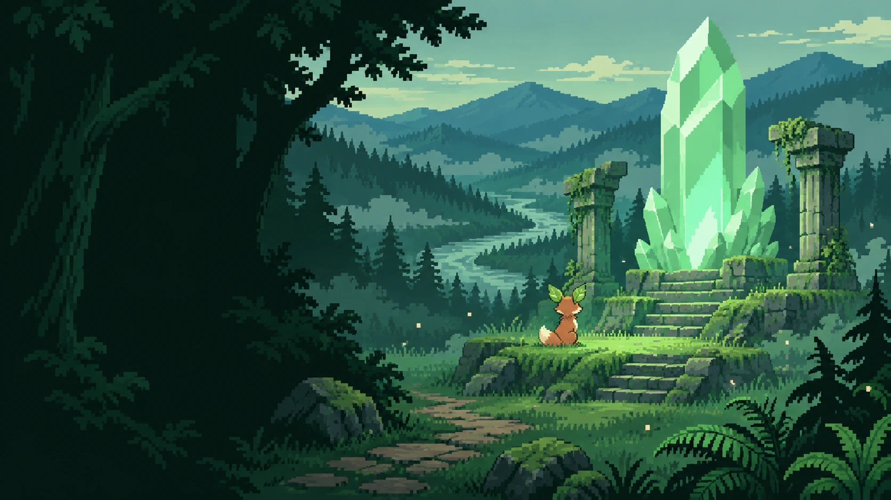

# Valle Chispa

Un clicker de navegador en pixel art. Despierta el cristal del Claro Esmeralda, adopta compañeros y usa tus chispas para llegar hasta el Santuario Astral.

[](https://26-oliver.github.io/Valle-Chispa/)
[](https://github.com/26-oliver/Valle-Chispa/issues/new)
[](https://ko-fi.com/V4I12AQ4QE)



## Empieza en el claro

Pulsa el cristal, **Púlsame** o la barra espaciadora para ganar chispas. En la **Tienda** puedes adoptar compañeros, mejorar tu producción y equipar gemas y efectos. En **Actividades** encontrarás los minijuegos, los encargos y las evoluciones de tus compañeros.

- **21 compañeros.** Cada uno vive en su mapa y produce chispas estés donde estés. Las pulsaciones y los aciertos en minijuegos les dan experiencia. Al evolucionar, duplican su producción.
- **Un minijuego por mapa.** Atrapa luciérnagas, pesca bajo el hielo, golpea al ritmo de la forja o sintoniza los ecos del firmamento.
- **Guardado local.** La partida se guarda en tu navegador. Los compañeros y las mejoras automáticas pueden seguir produciendo hasta dos horas con el juego cerrado.
- **Cuatro idiomas.** Puedes cambiar entre español, inglés, francés y portugués desde **Idioma** en el menú de inicio.

## Mapas del valle

Los mapas se desbloquean con el total de chispas que has ganado. Puedes gastar tu saldo en la tienda y seguir avanzando hacia el siguiente mapa.

| Mapa | Chispas acumuladas | Minijuego |
| --- | ---: | --- |
| Claro Esmeralda | Inicial | Atrapa luciérnagas |
| Cumbre Nevada | 2.500 | Pesca bajo el hielo |
| Gruta de Ámbar | 50.000 | Ritmo de la forja |
| Bosque Lunar | 750.000 | Faroles de luna |
| Islas del Viento | 12.000.000 | Corrientes del cielo |
| Santuario Astral | 180.000.000 | Ecos del firmamento |

## Jugar en local

El juego está hecho con HTML, CSS y JavaScript. Con Git y Python 3 instalados, abre una terminal y ejecuta:

```sh
git clone https://github.com/26-oliver/Valle-Chispa.git
cd Valle-Chispa
python3 -m http.server 8000
```

Después abre [la versión local](http://localhost:8000/).

## Apoya el juego

Si te gusta pasar un rato en el valle, puedes apoyar su desarrollo en [Ko-Fi](https://ko-fi.com/V4I12AQ4QE).
